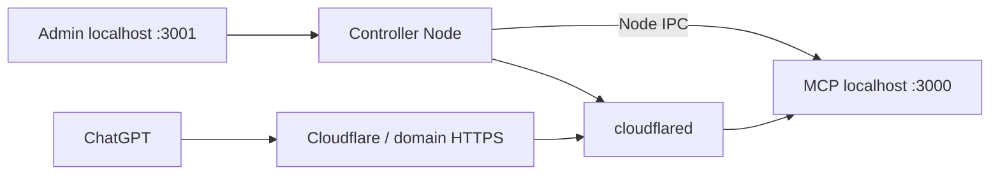

# ChatGPT Local Coder

MCP server cho ChatGPT: đọc/ghi file, chạy shell, git, patch và kết nối các MCP upstream. Panel tiếng Việt quản lý khởi chạy và setup Cloudflare Tunnel trên domain đã mua.

## Khởi chạy trên Windows

Yêu cầu: Windows x64, Node.js 22 trở lên, npm; Git nếu dùng công cụ git. Domain nằm trong một Cloudflare zone đã active.

```powershell
npm.cmd install
.\launcher.cmd
```

Launcher build dự án, mở controller tại `http://127.0.0.1:3001/ui/` và tự mở trình duyệt. Có thể dùng `npm.cmd run build` rồi `npm.cmd start`. Nếu PowerShell chặn script `.ps1`, dùng `launcher.cmd`.

Lần đầu, launcher mở link có mã bootstrap dùng một lần. Đặt mật khẩu admin từ 12–256 ký tự. Mã được giữ trong fragment URL, không gửi trong HTTP URL, và được UI xóa ngay. Mở `/ui/` thủ công trước khi tạo mật khẩu sẽ không có mã: đóng controller rồi mở lại launcher.

MCP và tunnel chưa tự chạy ở lần đầu. Sau khi setup, bấm **Chạy tất cả**. Tùy chọn **Tự chạy khi mở launcher** mặc định tắt. Không cài Windows service hoặc scheduled task.

## Cloudflare và domain đã mua

1. Thêm domain vào Cloudflare, đổi nameserver tại nơi mua domain và chờ zone **active**. Panel hiển thị nameserver nếu zone chưa active.
2. Tạo [Cloudflare API token](https://dash.cloudflare.com/profile/api-tokens), giới hạn account/zone cần sử dụng với các quyền:
   - Account → Cloudflare Tunnel → Edit.
   - Zone → Zone → Read.
   - Zone → DNS → Edit.
3. Trong **Cloudflare Tunnel**, lưu và kiểm tra token; chọn domain/account. Chọn hostname, ví dụ `mcp.example.com`, rồi tạo named tunnel hoặc chọn remotely-managed tunnel có sẵn.
4. Bấm **Xem trước thay đổi**. Bước này chỉ đọc API, chưa tạo tunnel hoặc DNS. Nếu hostname có DNS/ingress khác, panel từ chối ghi đè.
5. Bấm **Áp dụng** để tạo tunnel, cấu hình ingress và tạo CNAME được proxy qua Cloudflare. Chỉ đường dẫn `/mcp/<token>` tới MCP được public, các đường dẫn còn lại trả 404. Admin giữ tại localhost.
6. Bấm **Cài / cập nhật cloudflared**. Binary Windows x64 lấy từ release chính thức của Cloudflare trên GitHub và phải khớp SHA256 chính thức. Có thể đặt `CLOUDFLARED_PATH` cho binary đã cài.
7. Bấm **Chạy MCP & tunnel**, kiểm tra tunnel **connected**, rồi qua trang **Kết nối GPT**.

Cloudflare API token và tunnel token nằm trong vault mã hóa **Windows DPAPI CurrentUser**, không nằm trong `.env` hoặc command line. Vault chỉ mở bằng tài khoản Windows đã tạo nó; không mang file vault sang tài khoản/máy khác. Khi chuyển máy, tạo vault mới và nhập lại token qua wizard.

Nếu apply thất bại giữa chừng, panel lưu tunnel ID, tiến độ và lỗi tại bước bị dừng. Mở lại wizard sẽ khôi phục domain/hostname và hiển thị lỗi ngay trong preview. Bấm **Tiếp tục / thử lại** để tiếp tục; bấm **Xem trước thay đổi** với cùng cấu hình cũng mở lại setup đã lưu. Không tự xóa tunnel/DNS khi lỗi. Với lỗi 429, đợi theo `Retry-After` trước khi thử lại. Hoàn tất setup đang dở trước khi đổi sang cấu hình khác.

Nếu tạo tunnel báo HTTP 403, kiểm tra token có **Account → Cloudflare Tunnel → Edit** trên đúng account. Token chỉ có Read vẫn tải được domain/tunnel nhưng không tạo được tunnel. Sau khi sửa quyền hoặc nhập token mới, bấm **Tiếp tục / thử lại**; không cần xóa preview hay vault.

[Cloudflare Tunnel API](https://developers.cloudflare.com/tunnel/get-started/) · [Tunnel run parameters](https://developers.cloudflare.com/cloudflare-one/networks/connectors/cloudflare-tunnel/configure-tunnels/run-parameters/)

## Nhiều workspace trên cùng hostname

Controller chạy gateway tại `PORT` (mặc định 3000), còn mỗi workspace có MCP runtime và cổng nội bộ riêng. Cloudflare ingress hiện tại vẫn trỏ vào gateway; không cần tạo thêm hostname/DNS. URL khác nhau ở token:

```text
Workspace hiện tại: https://mcp.example.com/mcp/<token-default>
Blender:            https://mcp.example.com/mcp/<token-blender>
```

Gateway chuyển tiếp POST/GET/DELETE và SSE tới đúng runtime, không trả HTTP redirect. Token lạ trả 404; workspace đã dừng trả 503. Session đã được gateway ghi nhận thuộc workspace nào sẽ không dùng được trên workspace khác. Mỗi runtime có shell, checkpoint, audit, upstream config, OAuth, plugins và tool overrides riêng. Full machine access vẫn giữ nguyên; đây là tách trạng thái làm việc theo tiến trình.

Mở **Workspaces** để thêm/sửa thư mục dự án, Start/Stop/Restart từng runtime, xem cấu hình MCP upstream hoặc copy URL sau xác nhận mật khẩu. Token của workspace mới được lưu trong vault DPAPI; token/URL cũ của workspace mặc định được giữ lại. Registry nằm tại `.mcp-state/controller/workspaces.json`; cấu hình từng workspace nằm trong `.mcp-state/controller/workspaces/<id>/`. Mỗi workspace có tùy chọn tự chạy riêng. “Chạy tất cả” khởi chạy mọi workspace và tunnel chung; dừng một workspace không dừng tunnel.

Preset **Blender** được tạo một lần khi chuyển sang phiên bản này. Chọn thư mục dự án Blender thực tế trong panel (thư mục ban đầu là `.mcp-state/controller/blender-project`). Preset dùng bridge `uvx mcp-for-blender`, nối tới add-on local `127.0.0.1:9876`, và đặt `DISABLE_TELEMETRY=true` cho bridge. Có thể đổi command/args/BLENDER_HOST/BLENDER_PORT trong cấu hình MCP nếu đang dùng bridge khác. Add-on socket không phải endpoint MCP HTTP và không cần đưa cổng 9876 ra tunnel.

Với add-on đã cài: mở Blender, bật server của add-on, bấm **Chạy** workspace Blender rồi **Kiểm tra Blender MCP**. Nếu thiếu bridge, cài uv và chạy `uvx mcp-for-blender` hoặc để uvx tải bridge khi dùng lần đầu. Không chạy thêm bridge cho cùng Blender qua MCP client khác cùng lúc. [Hướng dẫn bridge/add-on và telemetry](https://github.com/ahujasid/mcp-for-blender).

Đổi `PORT` là đổi cổng gateway: cần thoát controller, mở lại launcher và áp dụng lại ingress. Cổng gateway/admin/metrics không được trùng cổng nội bộ đã dành cho workspace. Trang **Kết nối GPT**, **Cấu hình**, **MCP & công cụ** hiện dành cho workspace mặc định; workspace khác có URL và upstream editor trong **Workspaces**.

## Setup trên ChatGPT

Trang **Kết nối GPT** cung cấp URL đang chạy và URL đã lưu. Xác nhận mật khẩu admin để xem/copy URL đầy đủ:

```text
Server URL: https://mcp.example.com/mcp/<MCP_TOKEN>
Connection: Server URL
Authentication: No authentication
```

Token trong đường dẫn bảo vệ MCP. Coi toàn bộ URL như mật khẩu. `/mcp` trơn trả 404; MCP không thể chạy nếu token trống hoặc ngắn hơn 24 ký tự URL-safe.

Trong tài khoản ChatGPT hỗ trợ custom MCP, bật Developer mode, thêm app/plugin MCP bằng **Server URL**, chọn **No authentication**, rồi tạo kết nối. Mở chat mới, chọn app và yêu cầu gọi `agent_status` rồi `project_context`.

Bấm **Kiểm tra MCP qua domain** để initialize và list tools qua HTTPS. Check này không gọi các công cụ sửa file/chạy lệnh. Sau khi đổi token hoặc tool, Refresh app và mở chat mới. Nếu GPT báo app setup rate limited, chờ và kiểm tra tunnel/domain trước khi thử lại.

[Hướng dẫn custom MCP chính thức của OpenAI](https://developers.openai.com/api/docs/guides/custom-mcp-server)

## Panel quản trị

| Trang | Chức năng |
|---|---|
| Tổng quan | Start/Stop/Restart MCP, tunnel hoặc tất cả; PID, lỗi, số lần khôi phục; tùy chọn tự chạy và thoát ứng dụng |
| Cloudflare Tunnel | Token, domain/account, named tunnel, DNS/ingress preview, apply/retry và cài binary |
| Kết nối GPT | URL chính xác, chế độ xác thực, link quản lý, hướng dẫn và check domain |
| Cấu hình | Toàn bộ `.env`, giá trị đã lưu so với đang chạy, vault và đổi mật khẩu |
| MCP & công cụ | Config upstream, test/tools/OAuth, import Cursor/Claude/OpenCode/file, plugins, hooks và tool overrides |
| Nhật ký | MCP, tunnel, controller và tool activity; tìm/lọc và xuất JSON đã che token |

Config nhạy cảm mặc định được che. Xem/copy cần xác nhận mật khẩu lại, có hiệu lực 5 phút. Các giá trị đã che không được lưu ngược vào file config. `.env` giữ các comment và key chưa biết khi cập nhật.

Đổi `ADMIN_PORT` hoặc `PORT` cần **Thoát ứng dụng** rồi mở launcher lại. Khi đổi `PORT`, áp dụng lại ingress bằng Cloudflare wizard. Upstream/tool/plugin thay đổi có thể cần một phiên MCP mới.

Password dùng scrypt với salt ngẫu nhiên. Cookie phiên HttpOnly, SameSite=Strict; hết hạn khi không hoạt động 30 phút hoặc sau 8 giờ. Năm lần đăng nhập sai trong 15 phút khóa 15 phút. Logout/đổi mật khẩu thu hồi phiên; CSRF và Host/Origin bảo vệ API thay đổi dữ liệu. SSE không kéo dài thời gian phiên khi chỉ để panel mở.

Quên mật khẩu: **đóng controller trước**, sau đó chạy:

```powershell
npm.cmd run reset:admin
```

Reset chỉ xóa hash mật khẩu local rồi mở lại setup; giữ vault và cấu hình. Không có chức năng xem lại mật khẩu cũ.

## Tiến trình và dữ liệu



Controller sống độc lập với MCP. Đóng tab không dừng server; **Dừng tất cả** dừng tunnel trước rồi MCP, panel vẫn hoạt động; **Thoát ứng dụng** dừng cả controller. Launcher thứ hai mở panel đang chạy. Xung đột port được báo lỗi, không tự kill ứng dụng khác. Khôi phục crash tối đa 3 lần, chờ 2/5/15 giây; sau 60 giây ổn định reset số lần thử. Stop hủy các lần retry đang chờ. Tunnel chạy nhưng chưa connected được hiển thị riêng.

Dữ liệu local được giữ tại `.env`, `profiles/`, `.mcp-state/controller/`; hash mật khẩu và vault bị Git ignore. `/health` công khai chỉ trả name/status, không trả workspace/token/config. Các log mới và export che token đã biết; audit log cũ có thể vẫn chứa thông tin được ghi trước bản này.

**Full machine access vẫn được giữ:** `WORKSPACE_PATH` là thư mục mặc định, không phải sandbox. MCP có quyền đọc/ghi bất kỳ path và chạy shell theo quyền tài khoản Windows. Không có keylogger được thêm. Luồng kết nối gồm Cloudflare Tunnel/API, GitHub khi tải binary, ChatGPT và upstream/hook do người dùng cấu hình. Xem [SECURITY_REVIEW.md](SECURITY_REVIEW.md) cho kết quả rà soát trước cải tiến.

## Scripts cũ và runtime

`start.ps1`, `tunnel.ps1`, `stop.ps1` mở controller; thao tác Start/Stop thực hiện trong panel. `-Force` không kill port owner. `openai-tunnel.ps1` đã deprecated và không khởi chạy OpenAI Tunnel, không xóa credential cũ. `npm run tunnel` cũng mở controller Cloudflare.

`npm run start:runtime` chỉ chạy MCP cho chẩn đoán, không mở admin listener. `ADMIN_TOKEN` không dùng trong luồng controller. `CHATGPT_AUTO_APPROVE` là legacy preference; tool annotations luôn mô tả đúng rủi ro, không bỏ qua xác nhận của ChatGPT.

Vault và launcher được triển khai cho Windows x64. Runtime MCP vẫn dùng Node; setup DPAPI/cài binary không hỗ trợ macOS/Linux trong luồng panel này.

## Kiểm thử

```powershell
npm.cmd test
npm.cmd run test:all
npm.cmd run test:integration
npm.cmd run test:ui
```

`test:all` gồm test controller (auth/CSRF/DPAPI/IPC/lifecycle), Cloudflare API giả lập, download/checksum giả lập và MCP session. `test:integration` kiểm tra upstream và proxy tool qua runtime IPC. `test:ui` dùng Chrome/Edge headless đã cài, tạo fixture riêng và lưu screenshot trong `.tool-test-tmp/`.

Kiểm tra end-to-end với tài khoản Cloudflare/domain thật và app trên ChatGPT cần thực hiện sau khi người dùng nhập token/domain trong wizard. Các test tự động không sửa DNS hay tạo tài nguyên trong tài khoản thật.
